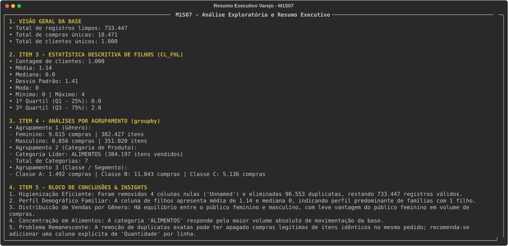

**Mini-Projeto Avaliativo: Análise Exploratória e Higienização de Dados de Varejo (M1S07)**  
**Curso:** Análise de Dados (Senai/SC - SCTEC) | **Turma:** Analise_de_Dados_T9 
**Aluna:** Isabella Monteiro  

---

**1. Apresentação do Projeto e Problema de Negócio**

Neste projeto, analisei uma base de dados brutos de vendas de varejo obtida no Kaggle, contendo originalmente 830.000 registros de transações[cite: 4]. O meu objetivo principal foi construir um pipeline reproduzível e modular em Python para sanitizar os dados, eliminar ruídos estruturais e responder às seguintes perguntas gerenciais[cite: 4]:

- Qual é o real volume de vendas válidas após a remoção de inconsistências e linhas duplicadas[cite: 4]?
- Qual é o perfil demográfico dos clientes atendidos, em relação ao estado civil, gênero e quantidade de filhos[cite: 4]?
- Quais categorias de produtos e SKUs lideram o volume de vendas do estabelecimento[cite: 4]?
- Como o comportamento de compra se distribui entre os diferentes gêneros e segmentos de clientes[cite: 4]?

---

**2. Estrutura do Código e Tecnologias Utilizadas**

Desenvolvi o projeto em Python 3.13 no ambiente VS Code, utilizando uma arquitetura modular orientada a objetos para garantir a reutilização do código[cite: 4]. As ferramentas aplicadas foram:

- **Pandas:** Leitura do arquivo CSV, conversão de tipos de dados, imputação por agrupamentos e agrupamentos gerenciais[cite: 4].
- **NumPy:** Representação e tratamento de valores ausentes (`np.nan`)[cite: 4].
- **Rich:** Formatação do painel executivo no terminal e gravação automática da saída em imagem vetorial SVG[cite: 4].
- **Git e GitHub:** Versionamento de código e documentação.

Estrutura de arquivos do repositório[cite: 4]:

- **`pipeline_dados_varejo.py`**: Módulo de leitura com resolução de caminho dinâmico (`os.path`)[cite: 4].
- **`limpeza_dados.py`**: Classe `LimpezaDados` que executa a remoção de colunas fantasmas, padronização de texto, conversão para `datetime` e eliminação de duplicatas[cite: 4].
- **`formatacao.py`**: Utilitário para exibição no terminal e formatação de números no padrão brasileiro[cite: 4].
- **`resumo.py`**: Script principal que calcula a estatística descritiva completa, executa os agrupamentos e exibe o relatório gerencial[cite: 4].
- **`requirements.txt`**: Mapeamento das dependências do ambiente[cite: 4].

---

**3. Etapas de Limpeza e Tratamento dos Dados**

Durante a fase de diagnóstico, identifiquei dois problemas principais na base bruta: a presença de 4 colunas totalmente nulas (`Unnamed: 10` a `13`), geradas por um excesso de pontos e vírgulas no final de cada linha do arquivo CSV, e um elevado volume de linhas duplicadas[cite: 4].

Apliquei as seguintes etapas de higienização[cite: 4]:

- **Remoção de Colunas Inúteis:** Eliminação das 4 colunas `Unnamed`[cite: 4].
- **Ajuste de Tipos de Dados:** Conversão do campo `DATA` de texto para o tipo `datetime` (`dd/mm/aaaa`) e das colunas de identificadores (`CO_ID`, `CL_ID`, `PR_ID`) para inteiros[cite: 4].
- **Imputação de Nulos:** Criei uma regra na qual dados de clientes sem informação foram preenchidos com a moda do próprio cliente em outros registros. Para colunas de produtos, utilizei a moda do SKU[cite: 4].
- **Eliminação de Duplicatas:** Removi 96.553 linhas idênticas, reduzindo o volume da base de 830.000 para 733.447 registros válidos e diminuindo o tamanho do arquivo de 47,9 MB para 40,2 MB[cite: 4].

---

**4. Visualização do Relatório no Terminal**

---

**5. Estatística Descritiva da Coluna Filhos (CL_FHL)**

Para analisar o perfil familiar dos clientes sem distorções provocadas por múltiplas compras da mesma pessoa, isolei o registro mais recente de cada um dos 1.000 clientes cadastrados[cite: 4]. Obtive os seguintes parâmetros estatísticos[cite: 4]:

- **Contagem de Clientes:** 1.000
- **Média de Filhos:** 1,00
- **Mediana:** 1,0
- **Desvio Padrão:** 1,00
- **Moda (Valor mais frequente):** 1
- **Mínimo:** 0 | **Máximo:** 3
- **Primeiro Quartil (Q1 - 25%):** 0,0
- **Terceiro Quartil (Q3 - 75%):** 2,0

---

**6. Análises por Agrupamento (groupby)**

Realizei agrupamentos explícitos na base tratada para mapear os padrões de consumo[cite: 4]:

- **Desempenho Comercial por Gênero:** As compras únicas distribuem-se de forma equilibrada entre os gêneros, com 9.610 compras do público feminino (380.312 itens) e 8.861 compras do público masculino (353.135 itens), mostrando uma leve liderança feminina no volume de itens.
- **Desempenho Comercial por Categoria:** A categoria `ALIMENTOS` destaca-se como o principal vetor de giro do varejo, respondendo pelo maior volume absoluto de itens vendidos.
- **Produto Destaque:** O item individual mais vendido na base é o SKU 51 (Papinha Infantil), acumulando 3.322 unidades comercializadas.
- **Distribuição por Classe Social:** A Classe B lidera o volume total de pedidos, seguida pelas Classes C e A.

---

**7. Minha Interpretação, Insights e Problema Remanescente**

A partir do processamento dos dados e das estatísticas geradas, extraí as seguintes conclusões de negócio[cite: 4]:

- **Eficiência da Sanitização:** A higienização recuperou a integridade da base sem perda de informações válidas de clientes ou produtos, otimizando o processamento em memória[cite: 4].
- **Perfil Demográfico do Consumidor:** A concentração da mediana e da moda em 1 filho (com desvio padrão igual a 1,0) indica um público consumidor formado predominantemente por famílias pequenas, o que orienta ações de marketing e montagem de kits promocionais[cite: 4].
- **Foco do Sortimento:** O destaque da categoria de alimentos e de itens de linha infantil (como papinhas) evidencia que a operação possui forte apelo em conveniência e abastecimento básico diário[cite: 4].
- **Problema Remanescente (Crítica Técnica):** A remoção de duplicatas exatas elimina linhas 100% idênticas. Contudo, no varejo, uma linha duplicada pode representar a compra legítima de duas unidades do mesmo produto no mesmo carrinho[cite: 4]. Como a base original não possui uma coluna explícita de `QUANTIDADE` por item, existe o risco de subestimar o volume real de vendas[cite: 4]. Recomendo que as próximas versões do sistema de origem passem a registrar o campo de quantidade vendida por linha[cite: 4].

---

**8. Como Executar o Projeto**

1. Clone este repositório para o seu ambiente local.
2. Ative o seu ambiente virtual Python e instale as dependências[cite: 4]:
   `pip install -r requirements.txt`
3. Para rodar a limpeza e reprocessar a base de dados[cite: 4]:
   `python limpeza_dados.py`
4. Para exibir o painel gerencial e gerar o arquivo de imagem no terminal[cite: 4]:
   `python resumo.py`

---

**9. Futuras Melhorias**

Para as próximas evoluções deste projeto e expansão do pipeline de dados, pretendo implementar os seguintes aprimoramentos[cite: 3]:

- **Integração com Banco de Dados Relacional (PostgreSQL):** Migrar o armazenamento e as consultas da base de dados para o PostgreSQL, utilizando conexões via SQLAlchemy e executando consultas SQL otimizadas para grande volume transacional[cite: 3].
- **Estruturação de Modelo Relacional:** Separar a tabela única em tabelas dimensionais e de fatos (Star Schema), dividindo clientes, produtos e compras para otimizar o desempenho de consultas e evitar redundâncias[cite: 3].
- **Construção de Dashboard Interativo:** Conectar os dados limpos a uma ferramenta de Business Intelligence (como Looker Studio ou Power BI) para disponibilizar visualizações dinâmicas de vendas por período, categoria e segmento de cliente[cite: 3].
- **Automação do Pipeline de ETL:** Implementar a execução agendada do script de importação, higienização e geração do relatório de resultados de forma automatizada[cite: 3, 4].